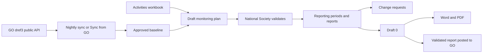

# DREF operational monitoring

DREF monitoring tracks an operation after GO has approved it, from the monitoring plan through routine reports to an operational update or final report. It lives in the Backoffice as the `dref_monitoring` plugin.

Open it from **Analytics & Monitoring → DREF monitoring**, or go to `/dref-monitoring/operations`. Portfolio staff also see a **DREF monitoring** tab in **Explore Data**. Settings are at `/admin/plugins/dref_monitoring/settings`.

The plugin does not replace GO. It reads approved stages from GO and keeps the monitoring record in the Databank. A validated Draft 0 is posted to the GO write API when `GO_API_TOKEN` is set. The nightly sync itself only reads the public feed.

## What starts monitoring

Monitoring starts when a sync finds an appeal on the public GO `dref3` feed. Every sync reads the whole feed. It does not stop at operations GO currently marks as active.

That feed already contains only approved records. A DREF application that is still in draft, in review, or not yet published on `dref3` does not appear, and the plugin does not create an operation for it.

These approved appeal types are included:

| GO appeal type | What the plugin treats it as |
|---|---|
| DREF | Response DREF. The plan is one activity group per sector that GO marked as active. |
| i-DREF, or a pillar that starts with “Anticip” | Imminent / anticipatory DREF. The plan uses Early actions and Early response instead of a single sector activity. Reporting defaults to every two weeks. |

Emergency Appeals (`EA`) appear on the same feed. The sync does not store them, and a later sync removes any that were stored earlier.

A new appeal code creates four things:

1. An operation record, linked to the Databank country when the ISO3 code matches.
2. A project with the appeal code as its reference, portfolio `DREF`, and fund `DREF` or `i-DREF`, when that country exists in the Databank. An unknown ISO3 stays on the operation page until the country exists.
3. A baseline snapshot of each approved GO stage in that pull (application, operational update, or final report). The latest stage is the one marked `is_latest_stage`, or otherwise the newest approval date.
4. A **draft** monitoring plan built from that latest stage. Workflow status becomes `plan_draft`.

Nothing is asked of the National Society until someone validates that plan. Reporting periods and project cycles are not opened at sync time. When GO later marks the operation closed, the project is closed and its cycles close with it.

### What does not start a new monitoring process

- The same appeal on a later sync, when the approved total, end date, and sector budgets and targets are unchanged. The operation stays as it is.
- A still-draft plan. The sync only refreshes the sector ceilings on that draft. Extra activities the National Society added are kept.
- A closed operation does not open a new monitoring cycle. It is still stored. The status comes from the latest GO stage that has one: a latest stage marked **closed** wins, and a blank latest stage falls back to the newest earlier stage that has a status. An older stage marked closed does not close an operation whose latest stage is still **active**. When the resolved status is closed, the workflow moves to `closure`.

### When an already monitored operation is sent back to plan validation

If the plan is already validated and a newer GO stage changes any of these, the plugin copies the plan into a new draft and sets the workflow back to `plan_draft`:

- total approved amount
- operation end date
- a sector budget or people targeted

The previous validated plan stays as history. The new draft uses the new ceilings. Cycles that were already opened stay, including any report already submitted. The National Society validates the new draft again, and periods that were not opened the first time are added then.

## How the GO connection works

GO does not push a webhook when an application is approved. The plugin pulls.

| | |
|---|---|
| Endpoint | `https://goadmin.ifrc.org/api/v2/dref3/` |
| Access | Public. No API key. Read only. |
| Filter | None. Active, closed, and rows GO left blank are all read in one pull. |
| Page size | 200 rows, up to 50 pages |
| When | Every day at 05:10 UTC, and when someone with manage access clicks **Sync from GO** on the settings page |
| Manual command | `flask dref-monitoring-sync` from `Backoffice/`. `--include-closed` is accepted and does the same thing. |

**Sync from GO** queues a background job and returns immediately. The settings page shows the status and progress (reading the feed, reading emergency pages, saving operations) and keeps polling until the job finishes. Leaving the page does not stop the job; opening the sync tab again resumes the same progress. Cancelling stops the pull and rolls back operations that have not been saved yet. The daily job and the command skip the pull when one is already running.

Each pull writes a row to the sync log (time, status, and how many appeals were created or updated). The settings page shows the last result.

Authenticated GO endpoints (`/api/v2/dref/`, operational update, and final report) are not used. Those accept writes, but this plugin does not call them and does not send monitoring data back.

`dref3` has the appeal header and 14 sector totals. The planned indicators and activities are on the public emergency page (`/api/v2/emergency/{id}/`, the id in `link_to_emergency_page`), on the approved application's `planned_interventions`. An imminent application also lists activities under `proposed_action`. When that page has no application, the plan falls back to one activity per sector.

### Fields copied from each GO stage

The operation header stores the appeal code, GO appeal id, disaster name, pillar, appeal type, allocation type, country name and ISO3, hazard, districts, region, onset, crisis category, amount approved, total approved, people affected, people targeted, disaster date, approval date, start date, end date, timeframe in months, and GO operation status.

Each sector that is switched on, or that has a budget or a people figure, is stored with:

- budget in CHF
- people targeted
- people assisted

The 14 sectors are shelter and basic household items, livelihoods, multi-purpose cash, health, water sanitation and hygiene, protection gender and inclusion, education, migration and displacement, risk reduction climate adaptation and recovery, community engagement and accountability, environmental sustainability, coordination and partnerships, secretariat services, and National Society strengthening.

People assisted is kept on the baseline. The generated plan target uses people targeted.

The country link is a match on ISO3 against the Databank country list. If there is no match, the operation is still created and the country name from GO is shown.

## The monitoring plan

The generated plan is organised as sector, then indicator, then activities, taken from the approved GO application when that page is available.

Each planned intervention becomes a sector. Its indicators become the plan indicators, and each line of its description becomes an activity. An imminent application's proposed actions are added as activities on the sector they were tagged with. A sector or indicator that does not match the indicator bank is flagged on the plan. Until the DREF team aligns GO wording with the bank, a temporary adapter links a GO title that is the same bank indicator (``# of`` for ``Number of``, a short extra clause, a translation, or a row that is not marked emergency) and the plan keeps that link marked as a temporary match. When the emergency page has no application, each included sector keeps the approved budget and people targeted, with one People reached or Activities completed indicator and one “Deliver {sector}” activity.

Further activities can be added under the same indicator. Each activity has a type, who carries it out, its own target, a budget, dates, and a status (planned, ongoing, completed, blocked, or delayed).

The National Society can edit the sector figures, the indicator, and the activities, and can replace the activity list with an Excel file. Adding or removing a sector, an indicator, or an activity after the plan is confirmed opens a new draft. Adding, removing, or renaming an activity keeps the justification on that plan version. Number changes inside the approved budget, targets, and dates still apply on the confirmed plan.

### Validating the plan

A user with the validation role opens the operation and clicks **Confirm the monitoring plan**. That sets the plan to validated, moves the workflow to `monitoring` (or `closure` if GO already says the operation is closed), and builds the reporting periods. Each period becomes a project cycle on the published template **DREF operational monitoring**. The cycle label is the appeal code and the period, for example `MDRMM024 · 2026-08`. Validating again does not open a second cycle for a period that already has one.

Settings include a plan-validation window, 14 days by default. The plugin stamps that date on the draft. It does not send a separate reminder for an unvalidated plan. The reminder job starts once periods exist, which is after validation.

### Excel import

On the operation page, upload an `.xlsx` file (maximum 5 MB) with a sheet named `Activities`, or the data on the first sheet. Columns, matched without case sensitivity:

Group, Activity, Indicator, Indicator type (`process` or `outcome`), Target, Unit, Budget CHF, Start, End, Beneficiary unit (`households`, `individuals`, or `none`).

Import replaces the groups on a draft plan. If the latest plan is already validated, import opens a new draft version and the workflow returns to `plan_draft`.

The workbook does not set the approved ceilings. Group names must be sector names from the latest GO stage (for an imminent operation, `Early actions: Health` or `Early response: Health`). The sector budget and people targeted come from GO, and a sheet whose activity budgets add up to more than a sector budget is refused, as is a negative amount or an end date before its start. When GO has sent no sector breakdown, the total of all budgets must stay within the approved allocation. The upload may hold up to 2,000 activity rows.

## What must stay inside the approved bounds

Bounds are the **latest** approved GO stage, not the original application. An operational update that raises the allocation becomes the new ceiling after the plan is rebased and validated again.

| Edit | Inside the bounds | Outside the bounds |
|---|---|---|
| Activity budget | The sector’s activities still add up to no more than the sector budget | A change request. The new budget is not applied until it is approved. |
| Activity start or end | On or inside the operation start and end dates | A change request |
| People-reached target | Not above the sector’s people targeted | A change request |
| Any date change, even inside the dates | Applied, and an entry is appended to the date history | Same, after approval. A date change without a justification is refused. |
| Reported expenditure | Always accepted as a number. It is not checked against the budget. | — |

Reported expenditure is **indicative**. Delegation finance validates it in ERP. The operation page, the report, the draft, and the Data Explorer tab say so.

The sign-off authority is chosen on the operation:

- **National Society** (the default): a validation-role user can approve or reject the change.
- **Delegation**: a technical-review user must approve or reject it.

Portfolio users can decide either kind of request. Approving an out-of-bounds change applies it and, for a date, writes the date history. Rejecting leaves the plan as it was.

## Routine reporting

Periods are built from the operation start and end when the plan is validated.

| Situation | Cadence | How a period is cut |
|---|---|---|
| Imminent DREF (`i-DREF`), or any operation of 60 days or less | Every two weeks | 14-day blocks. The due date is the period end. |
| Longer response DREF | Monthly | Through the end of each calendar month, then the operation end date. |

There are at most 36 periods. The cadence can be changed on the operation by a portfolio user. Open periods that do not yet have a report or a cycle are rebuilt. Periods that already have a report, and cycles already opened, are kept.

Each period has one report: draft, submitted, validated, then reviewed.

The country does not file that report from **Analytics & Monitoring → DREF monitoring**. A focal point for the country opens the project card on the country dashboard and saves the current cycle. The focal point does not need a DREF monitoring role to open the cycle.

The cycle form is the template **DREF operational monitoring**, one master form for every operation. It has a section for every sector and every indicator-bank indicator marked Emergency. An assignment lists only the indicators from that operation's monitoring plan, in their sectors, and the planned activities as cards. Each of those indicators collects one target, stored on the plan. It does not collect a reported total or a sex or age split. A focal point reports progress on the activities and does not add any. A note for the period sits in the Report section. The questions are worded in `plugins/dref_monitoring/scripts/report_questions.py`. Saving stores the answers on the assignment and the activity progress on the report.

On the cycle:

1. **Save** keeps the report as a draft.
2. **Submit** marks it submitted by the National Society.
3. **Approve** records National Society validation. An IFRC approver (a delegation address, the review permission, or an administrator) also marks it reviewed.

There is no separate report page. Submit and approve happen on the assignment. Plan validation, change requests, Draft 0, and the portfolio view stay on the operation.

A report that is no longer a draft is not reminded or escalated.

### Other records on the operation

- **Funds received**: a checkbox and a date. Each save is kept as an event.
- **Procurement**: an item and a milestone (`not_started`, `requested`, `ordered`, `received`, `distributed`).
- **Delays**: a reason, optionally tied to an activity.
- **Community feedback**: a channel and a summary.
- **Risks**: a title, likelihood, impact, status (`open`, `mitigated`, `closed`), and a mitigation note.

Community feedback stays on the operation and is not sent to the model. Delay reasons, change justifications, risks, and the monitoring history are included. Names and email addresses are not.

## Reminders and escalation

While the plugin is active, a job at 06:00 UTC checks reporting periods. Closed operations are skipped. A period with a submitted, validated, or reviewed report is skipped. The same level is not sent again for that period on the same calendar day.

Notifications go to people listed as members of that operation, and to people who hold a DREF role and have access to the operation's country. They do not go to everyone with a role. The level a person receives follows their tier: the membership tier, or the highest DREF role for country access.

| When | Level | Who is notified |
|---|---|---|
| From 3 days before the due date through the due date | Reminder | Data entry, validation, delegation review, and portfolio |
| 3 or more days late | Validation | Validation, delegation review, and portfolio |
| 7 or more days late | Delegation | Delegation review and portfolio |
| 14 or more days late | Portfolio | Portfolio |

The day counts are the defaults. They can be changed on the settings page. A late period that was still `open` is marked `overdue`. The link in the notification opens the cycle on the country dashboard when the period has one, and uses the cycle due date.

A plan that is still a draft is reminded separately. From 3 days before its validation date, and on every day after that until it is validated, the validation, delegation, and portfolio members of that operation are notified once a day. The link opens the operation.

Membership is required for these messages. A user who can see the operation only through country access, and who is not on the operation member list, does not receive the reminder.

## Draft 0

A data-entry user can generate **Draft 0** from the operation page, in English, French, Spanish, or Arabic. The daily job also creates one operational update when a reporting period falls due, and one final report when the operation end date is reached. A missed day is caught up for seven days. The same milestone is not drafted twice.

The model is the Databank OpenAI provider (`OPENAI_API_KEY`, `OPENAI_MODEL`). The switch is **off** by default. The payload is the approved request (hazard, dates, allocation, sectors) plus the monitoring history: each period’s activity status, people reached, indicator actuals, expenditure, delay reasons, change justifications, and the risk register. It does not include user names, email addresses, or community feedback. Notes, delay reasons, justifications, and risks go as typed, so keep names and contact details out of them. The model returns GO chapter text and must leave a chapter empty when the figures do not support it. The call is stored on the draft: model name, prompt version, a hash of the input, language, and whether the model was actually used. If the call fails, the document is still the tables.

The National Society edits the chapters on the draft page. Validation sends the report to GO (`dref-op-update` or `dref-final-report`) as a GO draft for formal processing. That post needs `GO_API_TOKEN`. A failed post stays validated so it can be sent again. Word and PDF stay available either way.

The draft page shows that document. The same document downloads as:

- **Word** (`.docx`), with Title, Heading 1, Heading 2, and Heading 3 styles, a cover table, and indicator tables
- **PDF**

Word and PDF follow the chapter order of a GO operational update or final report. Tables are filled from the latest monitoring report and the approved baselines. Chapter text comes from the model or from the National Society’s edit. Contact lines stay empty. Reach and expenditure in the tables are the latest report, not a sum across periods. The history sent to the model keeps each period.

## Who can do what

Assign one of these roles. Country access, or a row on the operation member list, decides which operations the person sees. A membership tier can narrow a higher role on that one operation. Portfolio access, and system managers, see every operation.

| Role | Can |
|---|---|
| Data entry | File reports, funds, procurement, delays, feedback, risks, and drafts. Edit the plan inside the bounds. |
| Validation | Also validate the plan and submitted reports, and sign off changes when the authority is the National Society. |
| Technical review | Also review reports, add or remove operation members, and sign off when the authority is the delegation. |
| Portfolio | Every operation, the reporting cadence and sign-off authority, and the Data Explorer tab. |
| DREF monitoring admin | Settings and **Sync from GO**, plus portfolio access. |

Partner National Society and delegation staff who are not in the operation’s country need an operation membership row as well as a role.

## Data Explorer

The **DREF monitoring** tab lists active operations, plans still awaiting validation, overdue reports, pending change requests, the sum of approved allocations, and the sum of reported expenditure. It also totals people reached, households reached, and activities completed across operations. Reported expenditure is the indicative figure. People and households are the latest report for each operation. The tab is visible to users with the portfolio or Data Explorer permission.

## Where to work

| Task | Where |
|---|---|
| Turn the plugin on | Admin → Plugins → DREF monitoring → Activate |
| Sync, reminders, and the Draft 0 switch | `/admin/plugins/dref_monitoring/settings` |
| One operation | `/dref-monitoring/operations`. Closed operations, and operations GO left without a status, are hidden until you choose **Show closed**. |
| Portfolio overview | Admin → Explore Data → DREF monitoring |
