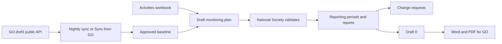

# DREF operational monitoring

DREF monitoring tracks an operation after GO has approved it, from the monitoring plan through routine reports to an operational update or final report. It lives in the Backoffice as the `dref_monitoring` plugin.

Open it from **Analytics & Monitoring → DREF monitoring**, or go to `/dref-monitoring/operations`. Portfolio staff also see a **DREF monitoring** tab in **Explore Data**. Settings are at `/admin/plugins/dref_monitoring/settings`.

The plugin does not replace GO. It reads approved stages from GO, keeps the monitoring record in the Databank, and exports a draft the National Society can paste into GO. It never posts a report back to GO.

## What starts monitoring

Monitoring starts when a sync finds an appeal on the public GO `dref3` feed. Every sync reads the whole feed. It does not stop at operations GO currently marks as active.

That feed already contains only approved records. A DREF application that is still in draft, in review, or not yet published on `dref3` does not appear, and the plugin does not create an operation for it.

These approved appeal types are included:

| GO appeal type | What the plugin treats it as |
|---|---|
| DREF | Response DREF. The plan is one activity group per sector that GO marked as active. |
| i-DREF, or a pillar that starts with “Anticip” | Imminent / anticipatory DREF. The plan uses Early actions and Early response instead of a single sector activity. Reporting defaults to every two weeks. |

Emergency Appeals (`EA`) appear on the same feed. The sync does not store them, and a later sync removes any that were stored earlier.

A new appeal code creates four things:

1. An operation record, linked to the Databank country when the ISO3 code matches.
2. A project with the appeal code as its reference, portfolio `DREF`, and fund `DREF` or `i-DREF`, when that country exists in the Databank. An unknown ISO3 stays on the operation page until the country exists.
3. A baseline snapshot of each approved GO stage in that pull (application, operational update, or final report). The latest stage is the one marked `is_latest_stage`, or otherwise the newest approval date.
4. A **draft** monitoring plan built from that latest stage. Workflow status becomes `plan_draft`.

Nothing is asked of the National Society until someone validates that plan. Reporting periods and project cycles are not opened at sync time. When GO later marks the operation closed, the project is closed and its cycles close with it.

### What does not start a new monitoring process

- The same appeal on a later sync, when the approved total, end date, and sector budgets and targets are unchanged. The operation stays as it is.
- A still-draft plan. The sync only refreshes the sector ceilings on that draft. Extra activities the National Society added are kept.
- A closed operation does not open a new monitoring cycle. It is still stored. The status comes from the latest GO stage that has one: a latest stage marked **closed** wins, and a blank latest stage falls back to the newest earlier stage that has a status. An older stage marked closed does not close an operation whose latest stage is still **active**. When the resolved status is closed, the workflow moves to `closure`.

### When an already monitored operation is sent back to plan validation

If the plan is already validated and a newer GO stage changes any of these, the plugin copies the plan into a new draft and sets the workflow back to `plan_draft`:

- total approved amount
- operation end date
- a sector budget or people targeted

The previous validated plan stays as history. The new draft uses the new ceilings. Cycles that were already opened stay, including any report already submitted. The National Society validates the new draft again, and periods that were not opened the first time are added then.

## How the GO connection works

GO does not push a webhook when an application is approved. The plugin pulls.

| | |
|---|---|
| Endpoint | `https://goadmin.ifrc.org/api/v2/dref3/` |
| Access | Public. No API key. Read only. |
| Filter | None. Active, closed, and rows GO left blank are all read in one pull. |
| Page size | 200 rows, up to 50 pages |
| When | Every day at 05:10 UTC, and when someone with manage access clicks **Sync from GO** on the settings page |
| Manual command | `flask dref-monitoring-sync` from `Backoffice/`. `--include-closed` is accepted and does the same thing. |

Each pull writes a row to the sync log (time, status, and how many appeals were created or updated). The settings page shows the last result.

Authenticated GO endpoints (`/api/v2/dref/`, operational update, and final report) are not used. Those accept writes, but this plugin does not call them and does not send monitoring data back.

`dref3` has no activity list. It has the appeal header and 14 sectors. Activity lines that are finer than a sector come from the Excel import described below.

### Fields copied from each GO stage

The operation header stores the appeal code, GO appeal id, disaster name, pillar, appeal type, allocation type, country name and ISO3, hazard, districts, region, onset, crisis category, amount approved, total approved, people affected, people targeted, disaster date, approval date, start date, end date, timeframe in months, and GO operation status.

Each sector that is switched on, or that has a budget or a people figure, is stored with:

- budget in CHF
- people targeted
- people assisted

The 14 sectors are shelter and basic household items, livelihoods, multi-purpose cash, health, water sanitation and hygiene, protection gender and inclusion, education, migration and displacement, risk reduction climate adaptation and recovery, community engagement and accountability, environmental sustainability, coordination and partnerships, secretariat services, and National Society strengthening.

People assisted is kept on the baseline. The generated plan target uses people targeted.

The country link is a match on ISO3 against the Databank country list. If there is no match, the operation is still created and the country name from GO is shown.

## The monitoring plan

The generated plan is organised as sector, then indicator, then activities.

For a response DREF, each included sector keeps the approved budget and people targeted. Under that sits one indicator:

- **People reached**, when GO sent a people-targeted figure
- **Activities completed**, when it did not

The sector starts with one activity, “Deliver {sector}”. Further activities can be added under the same indicator. Each activity has a type, who carries it out, its own target, a budget, dates, and a status (planned, ongoing, completed, blocked, or delayed).

For an imminent or anticipatory operation, each sector becomes two groups: Early actions (a process indicator) and Early response (the sector budget, people targeted, and a people-reached indicator). If GO sent no sectors, the plan is a single Operation group, or Early actions plus Early response for an imminent operation.

The National Society can edit the sector figures, the indicator, and the activities, and can replace the activity list with an Excel file. Adding or removing a sector, an indicator, or an activity after the plan is confirmed opens a new draft. Number changes inside the approved budget, targets, and dates still apply on the confirmed plan.

### Validating the plan

A user with the validation role opens the operation and clicks **Confirm the monitoring plan**. That sets the plan to validated, moves the workflow to `monitoring` (or `closure` if GO already says the operation is closed), and builds the reporting periods. Each period becomes a project cycle on the published template **DREF operational monitoring**. The cycle label is the appeal code and the period, for example `MDRMM024 · 2026-08`. Validating again does not open a second cycle for a period that already has one.

Settings include a plan-validation window, 14 days by default. The plugin stamps that date on the draft. It does not send a separate reminder for an unvalidated plan. The reminder job starts once periods exist, which is after validation.

### Excel import

On the operation page, upload an `.xlsx` file (maximum 5 MB) with a sheet named `Activities`, or the data on the first sheet. Columns, matched without case sensitivity:

Group, Activity, Indicator, Indicator type (`process` or `outcome`), Target, Unit, Budget CHF, Start, End, Beneficiary unit (`households`, `individuals`, or `none`).

Import replaces the groups on a draft plan. If the latest plan is already validated, import opens a new draft version and the workflow returns to `plan_draft`.

## What must stay inside the approved bounds

Bounds are the **latest** approved GO stage, not the original application. An operational update that raises the allocation becomes the new ceiling after the plan is rebased and validated again.

| Edit | Inside the bounds | Outside the bounds |
|---|---|---|
| Activity budget | The sector’s activities still add up to no more than the sector budget | A change request. The new budget is not applied until it is approved. |
| Activity start or end | On or inside the operation start and end dates | A change request |
| People-reached target | Not above the sector’s people targeted | A change request |
| Any date change, even inside the dates | Applied, and an entry is appended to the date history | Same, after approval. A date change without a justification is refused. |
| Reported expenditure | Always accepted as a number. It is not checked against the budget. | — |

Reported expenditure is **indicative**. Delegation finance validates it in ERP. The operation page, the report, the draft, and the Data Explorer tab say so.

The sign-off authority is chosen on the operation:

- **National Society** (the default): a validation-role user can approve or reject the change.
- **Delegation**: a technical-review user must approve or reject it.

Portfolio users can decide either kind of request. Approving an out-of-bounds change applies it and, for a date, writes the date history. Rejecting leaves the plan as it was.

## Routine reporting

Periods are built from the operation start and end when the plan is validated.

| Situation | Cadence | How a period is cut |
|---|---|---|
| Imminent DREF (`i-DREF`), or any operation of 60 days or less | Every two weeks | 14-day blocks. The due date is the period end. |
| Longer response DREF | Monthly | Through the end of each calendar month, then the operation end date. |

There are at most 36 periods. The cadence can be changed on the operation by a portfolio user. Open periods that do not yet have a report or a cycle are rebuilt. Periods that already have a report, and cycles already opened, are kept.

Each period has one report: draft, submitted, validated, then reviewed.

The country does not file that report from **Analytics & Monitoring → DREF monitoring**. A focal point for the country opens the project card on the country dashboard and saves the current cycle. The cycle shows one field, the operational report for that period. Saving writes the DREF tables. The focal point does not need a DREF monitoring role to open the cycle.

On a draft report the data-entry user records, per activity, the cumulative position to date:

- status: planned, ongoing, completed, blocked, or delayed
- percent complete
- people reached as one total
- the split of that total as percentages of women, men, girls, and boys, or a mark that disaggregation cannot be provided
- expenditure in CHF
- the actual for an indicator that is not people reached
- a narrative note for the period

Saving a draft on the cycle copies status and percent onto the activity and sums the expenditure lines onto the report.

On the cycle:

1. **Save** keeps the report as a draft.
2. **Submit** marks it submitted by the National Society.
3. **Approve** records National Society validation. An IFRC approver (a delegation address, the review permission, or an administrator) also marks it reviewed.

There is no separate report page. Submit and approve happen on the assignment. Plan validation, change requests, Draft 0, and the portfolio view stay on the operation.

A report that is no longer a draft is not reminded or escalated.

### Other records on the operation

- **Funds received**: a checkbox and a date. Each save is kept as an event.
- **Procurement**: an item and a milestone (`not_started`, `requested`, `ordered`, `received`, `distributed`).
- **Delays**: a reason, optionally tied to an activity.
- **Community feedback**: a channel and a summary.
- **Risks**: a title, likelihood, impact, status (`open`, `mitigated`, `closed`), and a mitigation note.

Feedback text and risk text stay on the operation. They are not included in the Draft 0 payload.

## Reminders and escalation

While the plugin is active, a job at 06:00 UTC checks reporting periods. Closed operations are skipped. A period with a submitted, validated, or reviewed report is skipped. The same level is not sent again for that period on the same calendar day.

Notifications go to people listed as members of that operation, not to everyone with a role.

| When | Level | Who is notified |
|---|---|---|
| From 3 days before the due date through the due date | Reminder | Data entry, validation, delegation review, and portfolio members |
| 3 or more days late | Validation | Validation, delegation review, and portfolio members |
| 7 or more days late | Delegation | Delegation review and portfolio members |
| 14 or more days late | Portfolio | Portfolio members |

The day counts are the defaults. They can be changed on the settings page. A late period that was still `open` is marked `overdue`. The link in the notification opens the cycle on the country dashboard when the period has one, and uses the cycle due date.

Membership is required for these messages. A user who can see the operation only through country access, and who is not on the operation member list, does not receive the reminder.

## Draft 0

At an operational-update or final-report milestone, a data-entry user generates **Draft 0** from the operation page.

The draft is built from structured monitoring data: sectors, activity status, people reached, indicator actuals, reported expenditure, procurement milestones, and counts of delays and pending changes. It does not include names, email addresses, the report narrative, or community-feedback text.

The language-model switch is **off** by default. Until it is enabled, and unless `OPENAI_API_KEY` is set, the draft is the monitoring tables in the GO chapter order. When the switch is on, the existing Databank OpenAI provider writes a narrative from that structured payload only. The call is stored on the draft: model name, prompt version, a hash of the input, and whether the model was actually used. If the call fails, the document is still the tables and the empty GO headings.

The draft page shows that document. The same document downloads as:

- **Word** (`.docx`), with Title, Heading 1, Heading 2, and Heading 3 styles, a cover table, and indicator tables
- **PDF**

Word and PDF follow the chapter order of a GO operational update or final report. Tables are filled from the latest monitoring report and the approved baselines. Chapters GO asks for that this record does not store (what happened, needs, strategy, contacts) stay in the outline empty, so they can be typed in Word. A model-written narrative is included as its own chapter. Reach and expenditure are the latest report, not a sum across periods. Someone still files the report in GO. The Word file and the PDF are the hand-off.

## Who can do what

Assign one of these roles. Country access, or a row on the operation member list, decides which operations the person sees. A membership tier can narrow a higher role on that one operation. Portfolio access, and system managers, see every operation.

| Role | Can |
|---|---|
| Data entry | File reports, funds, procurement, delays, feedback, risks, and drafts. Edit the plan inside the bounds. |
| Validation | Also validate the plan and submitted reports, and sign off changes when the authority is the National Society. |
| Technical review | Also review reports, add or remove operation members, and sign off when the authority is the delegation. |
| Portfolio | Every operation, the reporting cadence and sign-off authority, and the Data Explorer tab. |
| DREF monitoring admin | Settings and **Sync from GO**, plus portfolio access. |

Partner National Society and delegation staff who are not in the operation’s country need an operation membership row as well as a role.

## Data Explorer

The **DREF monitoring** tab lists active operations, plans still awaiting validation, overdue reports, pending change requests, the sum of approved allocations, and the sum of reported expenditure. Reported expenditure is the indicative figure. The tab is visible to users with the portfolio or Data Explorer permission.

## Where to work

| Task | Where |
|---|---|
| Turn the plugin on | Admin → Plugins → DREF monitoring → Activate |
| Sync, reminders, and the Draft 0 switch | `/admin/plugins/dref_monitoring/settings` |
| One operation | `/dref-monitoring/operations`. Closed operations, and operations GO left without a status, are hidden until you choose **Show closed**. |
| Portfolio overview | Admin → Explore Data → DREF monitoring |
